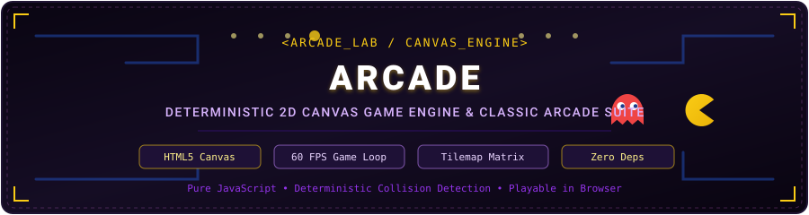
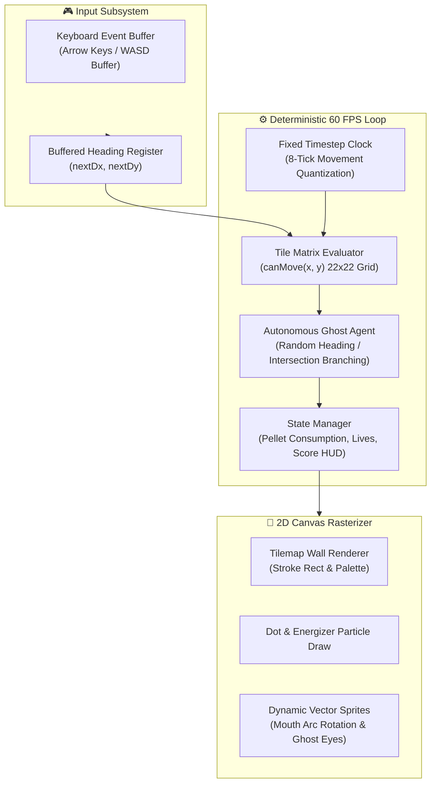

<p align="center">
  
</p>

<p align="center">
  <a href="https://github.com/Rithikasri-code/arcade"></a>
  
  
  
  
  <a href="LICENSE"></a>
</p>

---

## 🕹️ Overview

**Arcade** is a lightweight, zero-dependency 2D arcade game engine and interactive simulation laboratory implemented directly in vanilla JavaScript and HTML5 Canvas.

Designed to demonstrate core computer graphics and game engineering principles without heavy frameworks, the repository features deterministic fixed-timestep game loops, 2D tilemap collision matrices, procedural sprite rendering, and autonomous enemy patrol AI.

---

## 🏗️ Engine Architecture



---

## ⚡ Technical Highlights

* **Deterministic Grid-Based Collision:** Movement operates on a 22×22 discrete integer tilemap matrix where entity bounding circles are clamped to coordinate axes, eliminating clipping through corners.
* **Heading Buffering (`nextDx`, `nextDy`):** Replicates genuine arcade responsiveness by caching directional inputs before corridor intersections, turning automatically the exact moment a turn opens.
* **Autonomous Enemy Agents:** Patrolling ghosts assess non-reversing valid neighbor tiles at intersections, creating fluid, non-blocking path exploration.
* **Procedural Vector Drawing:** Zero external raster images required for core mechanics. Pacman's animated mouth angles, pellet energizers, and ghost eyes are calculated using pure Canvas trigonometry.

---

## 📂 Laboratory Modules

* **`index.html`** — Self-contained, responsive browser arcade cabinet with CRT HUD styling, scoring, and lives tracking.
* **`Pacman/`** — In-depth map architecture definitions (`map-dir.xlsx`), comprehensive engine specifications (`PensPlace Pacman-doc.md`), and screen manifest hierarchies.
* **`Lava Lamp/`** — Procedural metaball and ambient liquid simulation demonstrating dynamic canvas particle physics.

---

## 🚀 Running the Arcade

No build tools, bundlers, or package managers are required.

### Instant Play
Simply open [`index.html`](index.html) in any modern web browser:
```bash
# Or serve locally using Python:
python -m http.server 3000
```
Navigate to `http://localhost:3000` to play.

### Controls
* **Steer:** `Arrow Keys` or `W`, `A`, `S`, `D`
* **Objective:** Clear all yellow pellets while evading ghost patrols.

---

## 📄 License

Distributed under the **MIT License**. See [LICENSE](LICENSE) for details.
